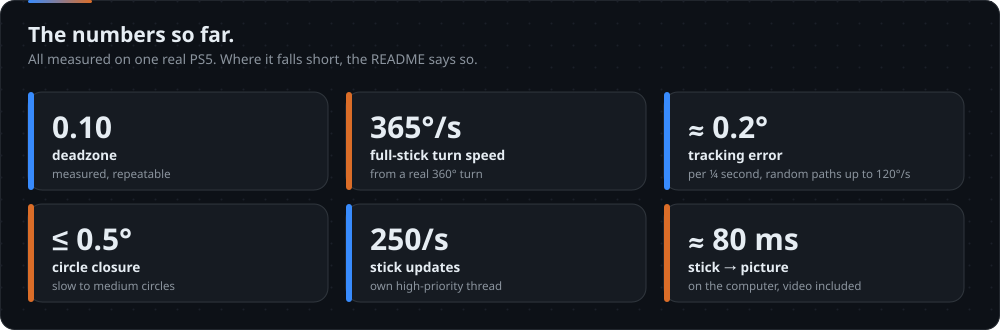
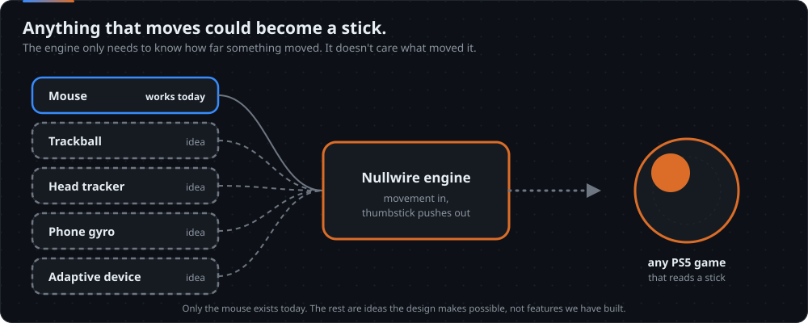
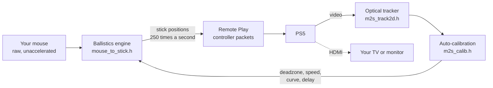
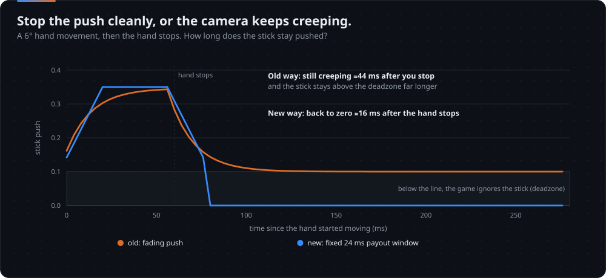
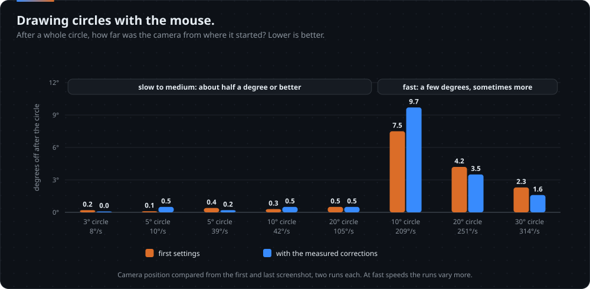
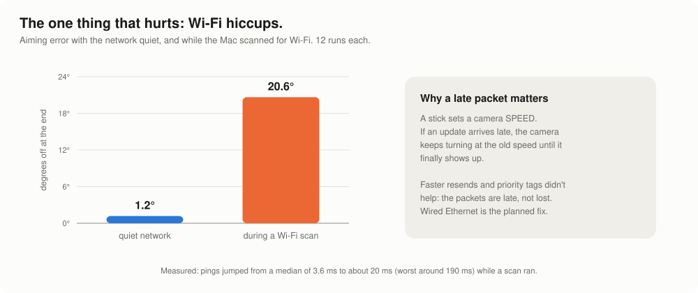

<div align="center">


**What if the PS5 could be played with anything that moves?**


</div>

---

## Let's start with a small, ridiculous problem

You have a mouse. It's a *great* mouse. It has been aiming at things your whole life.

You also have a PS5 and a game you love. The game wants a thumbstick.

So you do what everyone does: you put the mouse down, pick up the controller, and spend an evening re-learning how to look around with your thumb. Or you buy a small plastic gadget that translates your mouse into a stick, plugs into the console, and lives under constant threat of being switched off by the next system update.

We kept wondering: **why is a *translation* problem being solved with a *hardware* purchase?**

A mouse says *"I moved this far."* A stick says *"push this hard."* Turning one into the other is just math. Math doesn't need a gadget. It needs a way to talk to the console, and the PS5 already has one built in.

This repo is what happened when we tried.

> [!NOTE]
> **Where this stands:** a working prototype, tested on one real PS5 in one game, on one network. Every number in here that says "measured" was measured on that setup, and we tell you plainly where it falls short. The ambitious part is the *idea*. The numbers are deliberately modest.

<p align="center">
  
</p>

---

## The plot twist: your PS5 already has a door for this

Sony ships a feature called **Remote Play**: your console sends its picture to a laptop or phone, and the laptop or phone sends controller input back. That's all it is. A controller, on the network.

To the PS5, input arriving over Remote Play is just... a controller. It doesn't know or care whether the signal came from a thumb, a robot, or a very determined spreadsheet.

So here's the trick that makes Nullwire different from a typical Remote Play setup: **you don't have to play on the little window.** Keep your TV or monitor plugged straight into the console. Let the computer do something else entirely: listen to your mouse, do the math, and quietly send the console the stick movements that would have produced the same result.

The video on the computer isn't for you. It's for *the engine*. It watches the game so it can learn how the game behaves. More on that in a moment, because it's the part we're proudest of.

---

## Why this could change how you play

Right now this is a mouse on one PS5 in one game. But the engine at the heart of it only knows *"how far did something move?"*, and that opens a surprisingly big door.

<p align="center">
  
</p>

**1. Mouse aim on games that will never get it.**
Most console games will never add mouse support. Plenty of them, like adventures, strategy games, co-op shooters and campaigns, would simply be more comfortable with one.

**2. A bigger world for players who can't use a controller comfortably.**
A thumbstick demands a specific kind of grip and a specific kind of strength. A mouse, a trackball or a head tracker asks for something different. If *any* movement can be translated into a stick, then the controller stops being a gate. (Only the mouse works today, and the rest of this list is where the design points, not a promise.)

**3. A lab for measuring "game feel".**
Why does one shooter feel snappy and another mushy? Deadzones, response curves, hidden acceleration and input delay are real, measurable things, and almost no game documents them. Our auto-calibrator measures them from the outside, in about 30 seconds, for any game. Reviewers, accessibility testers and controller makers could use that on its own.

**4. Replayable, testable input.**
If input is just data, you can record it, replay it, and run the exact same hand movement a hundred times. That's how we found our own bugs, and it's how game testers could catch problems that "I think it felt off" never will.

**5. Your couch, your desk, your choice.**
Console games with a desk setup. Same game, different body.

If even one of those turns out to matter to somebody, this was worth building.

---

## First, understand the problem (it's a good one)

Think of driving a car.

- A **mouse is a steering wheel with a memory**: turn it a quarter turn and the car points a quarter turn. Stop turning and it stops.
- A **thumbstick is the gas pedal for turning**: push right and the camera keeps swinging right, faster the harder you push, *until you let go*.

<p align="center">
  
</p>

So when your mouse says *"turn exactly 40 degrees,"* the stick has to say *"push this hard, for exactly this long, then stop,"* and get the camera to land on the right spot. Do that 250 times a second, forever, and you have a mouse.

It sounds easy. It isn't, for four reasons:

| The trap | What goes wrong |
|---|---|
| **Deadzones** | Games ignore tiny stick pushes, so slow, careful mouse movements just vanish |
| **A speed limit** | A stick tops out. A fast flick can ask for more than the game will give |
| **Hidden quirks** | Looking up is slower than looking sideways. Diagonals bend. Nobody tells you |
| **The network** | Everything arrives a little late, and sometimes very late |

Nullwire is a collection of answers to those four traps.

---

## How it works



A loop with a brain in the middle: the mouse feeds the engine, the engine feeds the console, and the console's *video* feeds the engine's understanding of the game.

### Trick 1: Pay out the push, then stop *dead*

Our first version faded each push out smoothly, like a car coasting to a stop. It felt nice on paper. In the game, the stick sat just above the deadzone after you stopped, and the camera *crept*. Now every movement is queued and paid out evenly over a short fixed window, then the stick snaps to exactly zero.

<p align="center">
  
</p>

<p align="center"><sub>Drawn from the real engine's output (<code>scripts/figdata.cpp</code>).</sub></p>

### Trick 2: The flick reservoir

A stick has a top speed. A fast mouse flick can ask for far more than that. So the engine banks the extra turn in a reservoir and pays it out at full speed until the camera has gone the whole way. Reverse your hand mid-flick? It dumps the leftover and follows you, because **your hand always wins**.

<p align="center">
  
</p>

<p align="center"><sub>Today's default is the small reservoir: it keeps the stick responsive but caps how far one enormous flick can travel. Finding the best size is on the roadmap.</sub></p>

### Trick 3: Start just past the deadzone

The engine knows the game's measured deadzone and starts every movement right on the other side of it. So the very first millimeter of your mouse turns the camera, and slow, precise aim survives.

### Trick 4: Learn the game's secrets

When we measured the game, it had quirks nobody had told us about:

- **Looking up and down is slower than looking sideways** (about 0.68 to 0.74 of the speed for the same push). Uncorrected, every circle comes out as an egg.
- **Hard pushes get pulled toward the axes**, by about 9 to 11 degrees. That's what squared our circles off into rounded boxes.

<p align="center">
  
</p>

The engine now aims slightly the other way, so the camera lands where your hand *meant*.

---

## The part we're proudest of: it learns by watching

The first version of this project made a classic mistake: it *guessed* how the game behaved. The deadzone was a guess. The turn speed was a guess. Every guess was wrong in a small, annoying way.

So we taught it to look.

Press one key. The engine pushes the stick to known values, watches the game's video, and measures how fast the picture slides. About half a minute later it knows the deadzone, the response curve, the real turn speed, and the delay, **without a human counting anything.**

<p align="center">
  
</p>

It even has a built-in lie detector: if the speed keeps building while the stick is held still, it warns you that the game has ease-in or smoothing switched on, which no external tool can fully correct.

On simulated games with known answers, it recovers the deadzone, speed and curve and cuts aiming error by about an order of magnitude. On the real PS5, it settled on the same numbers every time we ran it.

---

## The receipts

*Setup: a real PS5, the Overwatch practice range, Remote Play through a patched [chiaki-ng](https://github.com/streetpea/chiaki-ng), macOS, on Wi-Fi. In-game: Linear Ramp aim, Aim Ease In 0, Aim Smoothing 0. Mouse movements were generated by the test harness, so every run is repeatable.*

### What the game does

<p align="center">
  
</p>

| Measured | Result |
|---|---|
| Deadzone | **0.100 to 0.106**, the same on repeated runs |
| Full-stick turn speed | **365 to 367°/s**, from a real 360° turn |
| Response curve | **within 0.04 of a straight line** |
| Looking up/down vs. sideways | **0.66 to 0.74** (0.68 used) |
| Stick-to-picture delay | **76 to 81 ms**, with the video's trip back to the computer included |
| Bridge update rate | **250 per second**, worst gap 6 to 8 ms, on its own thread |

### How closely the camera follows the mouse

<p align="center">
  
</p>

On a quiet network, with a level, detailed view:

| Test | Result |
|---|---|
| Small and medium circles (3 to 20° radius, slow to medium speed) | round and the right size; **ended 0.0 to 0.5° from where they started** |
| Real flicks of 5 / 10 / 20° | landed at about **5.0 / 9.4 to 9.8 / 19.3 to 20.9°** |
| Random two-axis paths, up to 120°/s | about **0.2°** of error per quarter second |
| Random two-axis paths, up to 300°/s | about **0.45°** of error per quarter second |

<p align="center">
  
</p>

<p align="center"><sub>The mouse draws each dashed circle exactly. The colored lines are where the camera really went, measured from the game's video. <a href="docs/circles.html">Open the interactive version.</a></sub></p>

---

## Where it bites (we'd rather you hear it from us)

A project that only shows you the good numbers isn't doing science, it's doing marketing.

<p align="center">
  
</p>

| Challenge | What we found |
|---|---|
| **Wi-Fi hiccups** | A Wi-Fi scan on the computer turned a typical ~1° error into ~20° (12 runs each). A stick sets *speed*, so a late update lets the camera keep turning at the old speed. Wired Ethernet is the expected fix, and **it is not tested yet** |
| **Extra packet tricks** | Priority tags, duplicate sends and faster resends made **no measurable difference**. The packets are late, not lost, so we left them off |
| **Very fast flicks** | The stick tops out around 365°/s. Fast circles typically ended ~2° off, sometimes up to ~9° |
| **Delay** | About 80 ms from command to the picture on the computer. The TV path should be shorter, but we haven't measured it |
| **One game, one setup** | Other games need their own calibration, which is exactly what the calibrator is for |
| **Game settings matter** | It wants a linear aim response with ease-in and smoothing off. Dual Zone and exponential curves are on the roadmap |

---

## The quest log

**Next up**
- [ ] **Go wired.** Rerun the Wi-Fi tests on Ethernet. If the scan penalty vanishes, the biggest problem is solved.
- [ ] **Record and replay a real person.** Capture human mouse movement and replay the exact same path many times, to see which glitches repeat (fixable) and which are random (the network).
- [ ] **A lean client.** Test whether a stripped-down Remote Play client with no video decoding keeps the console happy. That would free up the computer's CPU. It would *not* shrink network traffic, since the PS5 still sends video.

**Soon**
- [ ] A curve lookup table, so non-linear aim curves (Dual Zone, exponential) can be undone.
- [ ] Windows and Linux raw-input support.
- [ ] Per-game calibration profiles you can save and share.

**Big dreams**
- [ ] The other inputs from the picture above: trackball, head tracker, phone gyro, adaptive devices.
- [ ] A small learned model for the fast, direction-reversing movements a simple model can't explain, trained once and then frozen, so your aim stays the same under your hand.

---

## Try it

### Run the tests (no console needed)

Everything here runs against simulated games with known answers.

```bash
make test
```

That builds and runs the ballistics tests (`selftest`), the video tracker tests (`tracktest`) and the auto-calibration tests (`calibtest`). On macOS there's also a mouse-to-stick visualizer and a little 3D sandbox where the camera is driven *only* by the virtual stick:

```bash
make bin/m2s_test bin/sim3d
./bin/sim3d
```

### Use it with a real PS5

The bridge currently lives inside a patched copy of [chiaki-ng](https://github.com/streetpea/chiaki-ng).

1. Get chiaki-ng's source, copy this repo's `include/*.h` into `gui/include/` and `src/macMouseBridge.mm` into `gui/src/`.
2. Apply the patch: `git apply patches/chiaki-ng-m2s.patch`.
3. Build chiaki-ng on macOS (Qt6, ninja, `libevent`, OpenSSL 3 headers, and a Python environment with `protobuf` for the code generator).
4. Register your console as usual, connect, and press **`§`** (or backtick) to capture the mouse.

| Key | What it does |
|---|---|
| `§` or backtick | Capture or release the mouse |
| `+` / `-` | Mouse sensitivity |
| `b` | Run the auto-calibration. The camera turns by itself for about 30 seconds, so stand still somewhere safe |
| `1` or `l` | "That felt off": saves the last 10 seconds of mouse, stick and camera data for analysis |
| `j` / `k` | Shorter or longer payout window |

> [!TIP]
> In your game's controller settings, pick a **linear** aim response, set any ease-in or smoothing to **0**, and put the stick sensitivity at maximum. If something is secretly building speed, the calibrator will tell you.

---

## Questions we'd ask, too

**Is this cheating?**
In a competitive online game, a mouse against controller players is an advantage, and many publishers forbid converters. We built this for single-player games, co-op, accessibility and learning. If you use it online, check that game's rules first, and use an account you can afford to lose.

**Will Sony ban me?**
We don't know, and anyone who says "no" is guessing. Remote Play is an official feature, but publishers and platforms make their own rules about what's allowed in their games. Nullwire doesn't try to hide, and doesn't promise safety.

**Do I need to buy anything?**
No dongle, no cable to the console. You need a computer that can run Remote Play (so far, a Mac), and ideally a wired connection.

**Is it laggy?**
About 80 ms from command to the picture *on the computer*, which includes the video coming back. Your TV is on a different path that we haven't measured yet. What hurts more is Wi-Fi hiccups. That's why Ethernet is first on the quest log.

**Why a Mac?**
It's what this was built on. The engine itself is plain C++, and nothing in it is Mac-specific except reading the mouse.

**Why does it need the video at all?**
Only to learn. The engine uses it to measure the game. You can play looking at your TV.

---

## How this was built (the honest version)

It began as one question on a Tuesday night: *"Is there any way to use a mouse on a PS5 without buying anything?"*

The first answers were wrong in useful ways. The deadzone guess was off. The "how much slower is looking up" guess was off. Circles came out as eggs, then as rounded squares. Our own measuring tool lied to us more than once: a blank floor made it see imaginary camera movement, and a muzzle flash fooled it into thinking the camera jumped.

Every time, the fix wasn't *more cleverness*. It was **building something that could look**: a way for the computer to compare what the mouse asked for with what the camera actually did, and tell us the truth, including when it was the tool that was wrong.

If there's one lesson in this repo, it's that one. When you can't trust your guess, build a thing that can see.

---

## Credits and license

- Built on **[chiaki-ng](https://github.com/streetpea/chiaki-ng)** by streetpea and contributors, itself a fork of **[Chiaki](https://github.com/streetpea/chiaki-ng#credits)** by thestr4ng3r. Nullwire exists because they reverse-engineered Remote Play and gave it away.
- Nullwire's own standalone code (`include/`, `src/`, `tests/`, `scripts/`) is under the **MIT License** (see `LICENSE`).
- The chiaki-ng patch in `patches/` modifies an **AGPL-3.0** project, so it is **AGPL-3.0** too. Any build of chiaki-ng containing it carries those terms. If you plan to share builds publicly, read the license and consider legal advice first.
- Not affiliated with, endorsed by, or connected to Sony Interactive Entertainment or any game publisher. "PlayStation" and related names belong to their owners.
