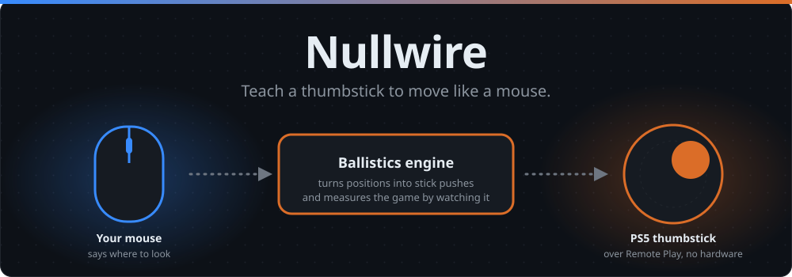
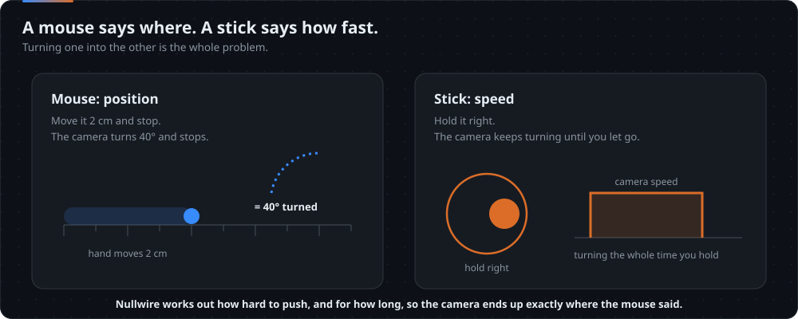
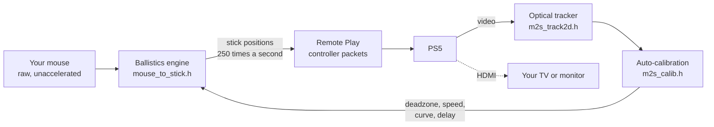
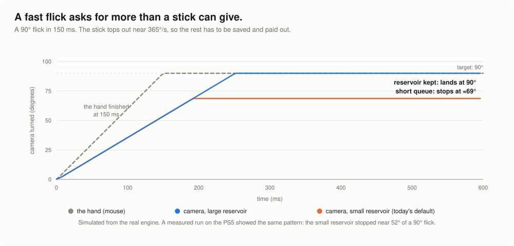
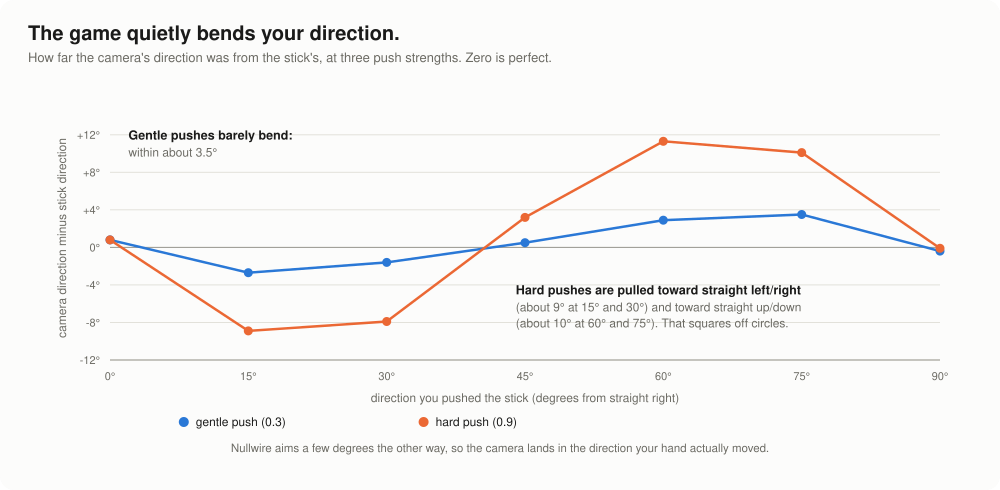
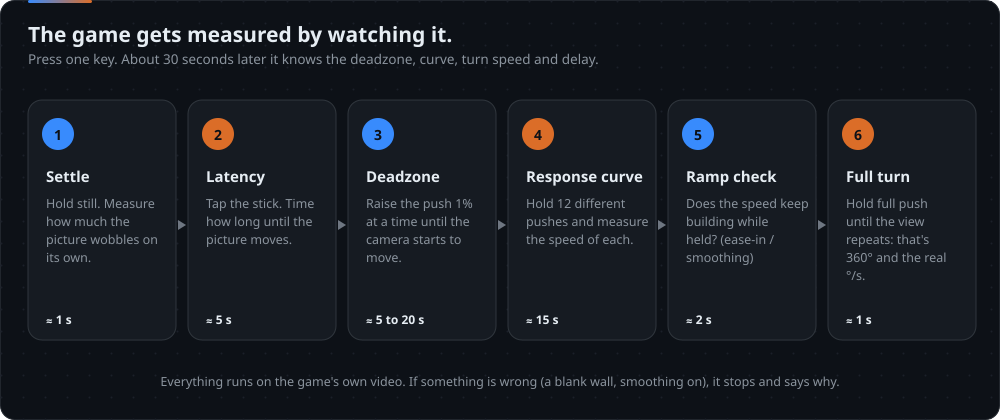
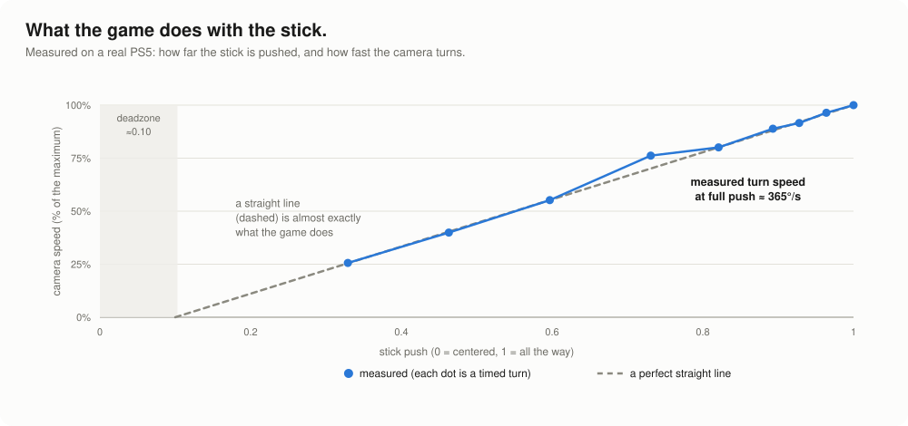
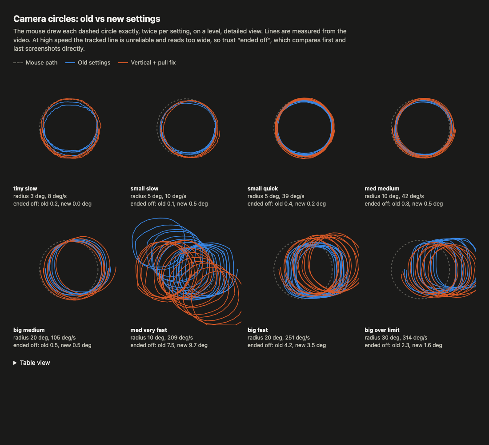

<div align="center">



**A zero-hardware way to give a PlayStation 5 mouse-precise aim, built on Sony's own Remote Play, and tuned by letting the computer watch the game and measure it.**


</div>

---

## The 30-second version

Console games read a **thumbstick**. People who want a **mouse** have had two choices: a game with built-in mouse support (rare), or a plastic adapter that costs real money.

Nullwire explores a third door. The PS5 already accepts a fully legitimate controller over the network: that's what **Remote Play** is. So instead of tricking the console with hardware, we send it the stick positions a mouse *would* have produced, computed by a small piece of math that understands how thumbsticks and cameras really behave.

The part we're proudest of: **it doesn't guess how the game responds. It looks.** It pushes the stick to known values, watches the game's video, and measures the deadzone, the turn speed and the response curve by itself.

> [!NOTE]
> This is a working prototype, tested on one real PS5 in one game. Everything in this README that says "measured" was measured on that setup, and we say plainly where it falls short. Honest numbers are the whole point.

<p align="center">
  
</p>

---

## Why this is exciting

**Accessibility.** A mouse is a different kind of control than a thumbstick. For some players with hand or thumb conditions, it is far more comfortable. Software that makes a mouse work on any console game, with no extra devices, could genuinely open games up.

**Games that never got mouse support.** Single-player adventures, co-op games, strategy and shooter campaigns: plenty of games would be nicer with a mouse, and most will never add it.

**A measuring instrument for controller feel.** The auto-calibration part works on its own. Point it at a game and it reports the real deadzone, the real response curve, the real turn speed and the real input delay. People who tune controllers, review games, or build them have never had that in one click.

**No dongle, no wiring.** Nothing to buy, nothing to plug into the console.

---

## The idea, in plain English

Think of a car.

- A **mouse is a steering wheel with a position**: turn it a quarter turn and the car points a quarter turn that way. Stop moving, and it stops.
- A **thumbstick is a gas pedal for turning**: push right and the camera *keeps* turning right at a speed set by how far you pushed, until you let go.

So a mouse says **"turn exactly 40 degrees."** A stick can only say **"turn at this speed until I say stop."** Turning one into the other means working out, many times a second, *how hard to push the stick, and for how long, so the camera ends up exactly 40 degrees around.*

<p align="center">
  
</p>

That's the entire problem, and it's trickier than it looks:

- Games ignore tiny pushes (a **deadzone**), so slow, careful mouse movements vanish.
- A stick has a **top speed**, so a fast flick can ask for more than the stick can give.
- The game bends the stick's response in ways nobody tells you: slower looking up and down, a slight pull toward straight lines, curves.
- Everything arrives over a network, so there's delay and sometimes a late packet.

Nullwire is a collection of answers to those four problems.

---

## How it works



1. **Your mouse** is read raw, with no macOS pointer acceleration, so the same hand movement always means the same thing.
2. **The ballistics engine** turns movement into stick positions, 250 times a second, on its own high-priority thread so a busy app can't make it stutter.
3. **Remote Play** carries those positions to the PS5, which treats them as an ordinary controller.
4. **The video loop** is how it learns. An optical tracker watches the picture slide and measures how fast the camera really turned, and the calibration routine uses that to tune the engine.

You can keep playing on your TV over HDMI. The video on the computer exists to teach the engine, not to play from.

---

## The tricks that make it work

### 1. The payout window
When the mouse moves, the engine doesn't dump the whole push into one instant. It queues the angle and **pays it out evenly over a short window** (24 ms by default), then returns the stick to exactly zero. An earlier version let the push fade out slowly, and the stick lingered near the deadzone edge for about 150 ms after you stopped, which made the camera creep. A fixed window fixes it.

<p align="center">
  
</p>
<p align="center"><sub>Drawn from the real engine's output (<code>scripts/figdata.cpp</code>).</sub></p>


### 2. The flick reservoir
Flick faster than the stick's top speed and the camera can't keep up. The engine banks the extra turn and pays it out at full tilt, so a big flick still goes the full distance. If you reverse direction mid-flick, it drops the leftover and does what your hand is doing *now*, because your hand always wins.

<p align="center">
  
</p>
<p align="center"><sub>Today's default is the small reservoir, which keeps the stick responsive but caps how far one huge flick can go. Choosing the best size is on the roadmap.</sub></p>


### 3. The deadzone kiss
Games ignore small stick pushes. Nullwire knows the measured deadzone and starts every movement *just past* it, so the very first millimeter of mouse movement turns the camera. Slow, precise aiming survives.

### 4. Measuring the game's quirks
The tests found real quirks, and the engine corrects for them:
- **Looking up and down is slower than left and right** (about 0.68 to 0.74 of the horizontal speed for the same stick push). Uncorrected, circles come out as ovals.
- **Hard pushes get pulled toward the axes** (about 9 to 11 degrees off-angle on hard pushes), which squares off diagonal and circular motion. The engine aims slightly off to land on the right direction.

<p align="center">
  
</p>


### 5. Self-calibration from video
Press one key and the routine runs five stages: **settle**, **latency**, **deadzone**, **response curve**, then a **full 360-degree turn** to get real degrees per second. It also warns if the speed keeps building while you hold the stick (a sign that in-game ease-in or smoothing is on, which can't be corrected from the outside).

On simulated games with known answers, it recovers the deadzone, speed and curve and cuts the aiming error by an order of magnitude. On the real PS5 it settled on the same numbers every time.

<p align="center">
  
</p>


---

## What we measured

*Setup: a real PS5, the Overwatch practice range, Remote Play through a patched [chiaki-ng](https://github.com/streetpea/chiaki-ng), macOS, Wi-Fi. In-game: Linear Ramp aim, Aim Ease In 0, Aim Smoothing 0. Mouse movements were generated by the test harness so every run is repeatable.*

### What the game does

| Measured | Result | Note |
|---|---|---|
| Deadzone | **0.100 to 0.106** | Same on repeated runs |
| Full-stick turn speed | **365 to 367 deg/s** | Measured with a real 360-degree turn |
| Response curve | **Within 0.04 of a straight line** | So a simple model is enough |
| Looking up/down vs left/right | **0.66 to 0.74** | 0.68 is used |
| Stick-to-picture delay | **76 to 81 ms** | Includes the video trip back to the Mac |
| Bridge update rate | **250 per second**, worst gap 6 to 8 ms | Own high-priority thread |


<p align="center">
  
</p>

### How accurately the camera follows the mouse

On a quiet network, with a level, detailed view:

| Test | Result |
|---|---|
| Small and medium circles (3 to 20 degree radius, slow to medium speed) | Drawn round and the right size; **ended 0.0 to 0.5 degrees from where they started** |
| Real flicks, 5 / 10 / 20 degrees | Landed at about **5.0 / 9.4 to 9.8 / 19.3 to 20.9** degrees |
| Random two-axis paths, up to 120 deg/s | About **0.2 degrees** of error per quarter second |
| Random two-axis paths, up to 300 deg/s | About **0.45 degrees** of error per quarter second |


<p align="center">
  
</p>

<p align="center">
  
</p>

<p align="center"><sub>The mouse draws each dashed circle exactly. The colored lines are where the camera really went, measured from the game's video. <a href="docs/circles.html">Open the interactive version.</a></sub></p>

---

## The honest part: where it isn't there yet

We would rather you trust the good numbers than be surprised by the rest.

<p align="center">
  
</p>


| Challenge | What we found | What it means |
|---|---|---|
| **Wi-Fi hiccups** | A Wi-Fi scan on the Mac turned a typical ~1 degree error into ~20 degrees (12 runs each) | The stick sets *speed*, so a late update keeps the camera turning at the old speed. Wired Ethernet is the expected fix, and **it is not tested yet** |
| **Extra packet tricks** | Priority tagging, duplicate sends and faster resends made **no measurable difference** | Late packets, not lost ones, are the problem. We left them off |
| **Very fast flicks** | The stick tops out around 365 deg/s. Fast circles typically ended about 2 degrees off, sometimes up to ~9 | A hard physical ceiling of the stick, unless a game setting raises it |
| **Delay** | About 80 ms from command to the picture on the computer | The TV path should be shorter, but we haven't measured it |
| **One game, one setup** | Everything above is one game on one console and one network | Other games will need their own calibration. That's what the calibrator is for |
| **Game settings matter** | Needs a linear aim response with ease-in and smoothing off | Dual Zone and exponential curves are a roadmap item |

---

## Roadmap

**Next up**
- [ ] **Go wired.** Rerun the Wi-Fi tests on Ethernet. If the scan penalty disappears, the biggest problem is solved.
- [ ] **Record and replay.** Record a real person's mouse movement and replay the exact same path many times to see which glitches repeat (fixable) and which are random (network).
- [ ] **A lean client.** Test whether a stripped-down Remote Play client with no video decoding keeps the PS5 session alive. This would free the computer's CPU. It would *not* reduce network traffic, since the PS5 still sends video.

**Soon**
- [ ] A curve lookup table so non-linear aim curves (Dual Zone, exponential) can be inverted.
- [ ] Windows and Linux raw-input support.
- [ ] Calibration profiles per game, saved and shared.

**Research ideas**
- [ ] A small learned model for the very fast, direction-reversing movements the simple model can't explain, trained once and then frozen so aim stays consistent under your hand.

---

## Try it

### Run the tests

No console needed. Everything here runs against simulated games with known answers.

```bash
make test
```

This builds and runs the ballistics tests (`selftest`), the video tracker tests (`tracktest`) and the auto-calibration tests (`calibtest`).

On macOS there is also a mouse-to-stick visualizer and a small 3D sandbox where the camera is driven *only* by the virtual stick:

```bash
make bin/m2s_test bin/sim3d
./bin/sim3d
```

### Use it with a PS5

The bridge currently lives inside a patched copy of [chiaki-ng](https://github.com/streetpea/chiaki-ng).

1. Get chiaki-ng's source, then copy this repo's `include/*.h` into `gui/include/` and `src/macMouseBridge.mm` into `gui/src/`.
2. Apply the patch: `git apply patches/chiaki-ng-m2s.patch`.
3. Build chiaki-ng on macOS (Qt6, ninja, `libevent`; OpenSSL 3 headers; a Python environment with `protobuf` for the code generator).
4. Register your console as usual, connect, and press **`§`** (or backtick) to capture the mouse.

| Key | What it does |
|---|---|
| `§` or backtick | Capture or release the mouse |
| `+` / `-` | Mouse sensitivity |
| `b` | Run the auto-calibration (the camera will turn by itself for about 30 seconds, so stand still in a safe spot) |
| `1` or `l` | Mark a hitch. Saves the last 10 seconds of mouse, stick and camera data for analysis |
| `j` / `k` | Shorter or longer payout window |

> [!TIP]
> In your game's controller settings, use a **linear** aim response, set any ease-in or smoothing to **0**, and put the sticks at maximum sensitivity. The calibrator tells you if something is building speed behind its back.

---

## Fair play, in one honest paragraph

A mouse on a console is, in many competitive online games, against the rules, and publishers do act on accounts. That is true no matter how the input reaches the console. Nullwire makes no attempt to hide and does not promise safety from bans. We built it for **single-player, co-op, accessibility and learning**, and we'd ask you to use it that way. If you try it online, read that game's rules first, and don't use an account you can't afford to lose.

---

## How this was built

This began as one question on a Tuesday night: *"Is there any way to use a mouse on a PS5 without buying anything?"*

The first answers were wrong in useful ways. A guess at the deadzone was off. A guess at how much slower looking up and down is was off. Circles came out as ovals, then as rounded squares. Each time, the fix wasn't more cleverness. It was **measuring**: building a way for the computer to watch the game, compare what the mouse asked for with what the camera did, and tell us the truth, including when the tool measuring it was the thing that was wrong (it was, more than once).

If there is one lesson in this repo, it's that: when you can't trust your guess, build something that can look.

---

## Credits and license

- Built on **[chiaki-ng](https://github.com/streetpea/chiaki-ng)** by streetpea and contributors, itself a fork of **[Chiaki](https://github.com/streetpea/chiaki-ng#credits)** by thestr4ng3r. Nullwire exists because they reverse-engineered Remote Play and gave it away.
- Nullwire's own standalone code (`include/`, `src/`, `tests/`, `scripts/`) is under the **MIT License** (see `LICENSE`).
- The chiaki-ng patch in `patches/` modifies an **AGPL-3.0** project and is therefore under **AGPL-3.0**. Any build of chiaki-ng containing it carries those terms. If you plan to share builds publicly, read the license and consider legal advice first.
- Not affiliated with, endorsed by, or connected to Sony Interactive Entertainment or any game publisher. "PlayStation" and related names belong to their owners.
